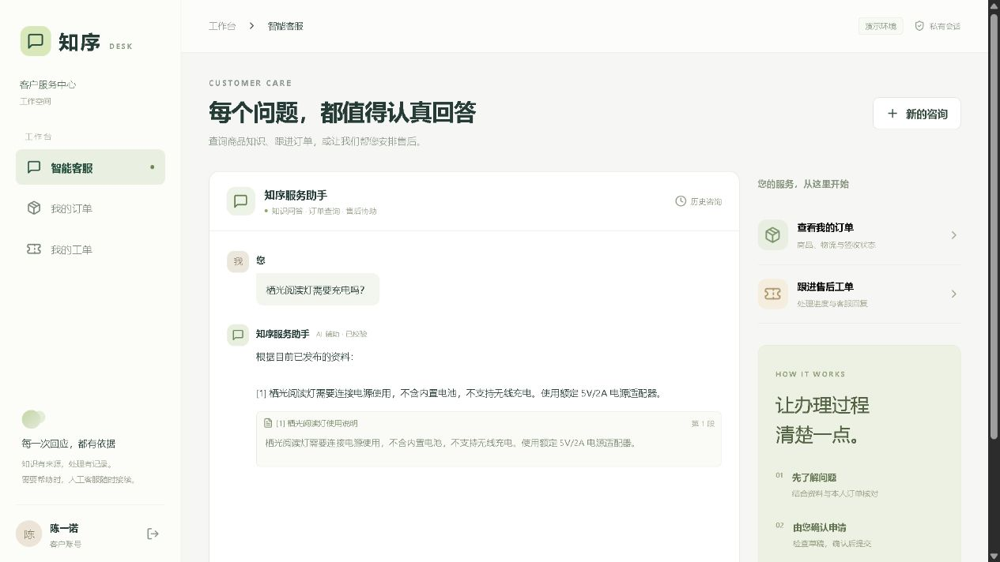

# 知序 · Java + AI 智能客服与售后工单系统

[](https://github.com/daihuohuo2/java-ai-service-desk/actions/workflows/ci.yml)
[](LICENSE)

本项目将商品知识问答、本人订单查询、AI 售后草稿、客户确认、人工工单处理和审计记录串成完整流程。Java 负责权限与业务决策，模型负责理解意图和选择资料。数据均为虚构，可用于本机演示与作品投递。

Java + Spring AI customer service desk with local Ollama models, grounded knowledge answers, order access control and a human-confirmed after-sales workflow.



## 立即体验

完成下方构建和启动后，打开 **http://127.0.0.1:19082/**。这是本地入口，项目未提供公共在线演示服务；Docker Desktop 须处于运行状态。

| 身份 | 用户名 | 本机演示密码 | 能力 |
|---|---|---|---|
| 客户 | customer | DemoCustomer!2026 | 本人订单、知识问答、售后申请、工单回复 |
| 第二客户 | customer2 | DemoCustomer!2026 | 用于验证跨账号隔离 |
| 客服 | agent | DemoAgent!2026 | 工单接单、补充材料、解决、运营概览 |
| 管理员 | admin | DemoAdmin!2026 | 客服能力，以及知识、商品和审计管理 |

登录页点击角色即可填入对应演示账号。这些是公开的虚构演示账号，不能作为互联网环境的正式账户使用。

推荐演示：询问“栖光阅读灯需要充电吗？” → 展开原文引用 → 查询 `ZS20261030001` → 请求退货退款 → 核对草稿并确认 → 切换客服接单并解决 → 客户确认关闭。详细讲解见 [演示说明](docs/demo.md)。

## 技术实现

刚学 Java？先看 [从 Java 基础读懂项目](docs/learning/从Java基础读懂项目.md)，配套 `learning/OrderLesson.java` 可直接运行。

- Java 21 / Spring Boot 4.1.2 / Spring AI 2.0.2 / Spring Security / JDBC / Flyway。
- React 19 / TypeScript / Vite，自适应客户工作台与管理工作台。
- PostgreSQL 17 用于容器部署；H2 用于无需容器的开发与测试。
- Ollama + Qwen3 4B Instruct + Qwen3 Embedding 0.6B，本地推理，不要求付费闭源 SDK 或云 API Key。
- 中文二元字符检索与向量余弦相似度混合排序；商品范围过滤，模型选择资料 ID，后端逐一校验引用并输出原文。
- Cookie 会话、CSRF、角色权限、订单/会话归属检查；工单行锁、版本号与幂等键；AI 草稿二次确认；错误与超时降级。
- SSE 提供处理阶段与校验后的完整结果，不直接向客户输出未经校验的模型 token。

## 构建与启动

构建需要 JDK 21、Node.js 24、Docker Compose v2，以及首次下载依赖的网络。项目自带 Maven Wrapper，固定 Maven 3.9.16。

```powershell
git clone https://github.com/daihuohuo2/java-ai-service-desk.git
cd java-ai-service-desk
.\scripts\build.ps1
.\scripts\start.ps1 -ManagedModels
```

默认使用独立模型卷。支持 NVIDIA GPU 的 Docker 环境可用以下命令加速；CPU 模式较慢，其性能尚未专门验收：

```powershell
.\scripts\start.ps1 -ManagedModels -Gpu
```

GitHub 仓库提供源码，需先构建。首次启动会自动创建 `.env` 并生成随机数据库密码，还需下载容器镜像及约 3.2 GB 模型权重。已有模型服务时可配置 `OLLAMA_URL` 并省略 `-ManagedModels`。Linux 步骤见 [部署说明](docs/deployment.md)。

只运行自动测试不需要 Docker、GPU 或下载模型：

```powershell
.\backend\mvnw.cmd -f backend/pom.xml verify
npm.cmd ci --prefix frontend
npm.cmd test --prefix frontend
npm.cmd run build --prefix frontend
```

GitHub Actions 另外使用独立 PostgreSQL 测试库执行后端测试。CI 中模型为 Mock；真实模型验收使用 [验收脚本](scripts/live-acceptance.mjs) 在部署后的演示环境中运行。

## 文档与验收证据

2026-10-31 升级版已通过：49 项 Java 测试分别在 H2 与 PostgreSQL 执行、9 项前端测试与生产构建、19 项 HTTP 验收、12 个模型场景行为检查及工单闭环。最终模型轮次含 1 次安全降级。VS Code 显示 0 错误、0 警告，原本机服务已更新。变更、备份与边界见 [升级验收报告](docs/upgrades/20261031-spring-boot-4.md)。2026-10-30 的 ZIP 解压部署验收属于旧版本历史证据。

历史本机交付 ZIP、数据库、模型、环境配置和机器诊断日志未上传。公开的验收摘要与虚构场景记录见 [证据说明](docs/verification/README.md)。

| 材料 | 路径 |
|---|---|
| 需求与图片要求对应 | [requirements.md](docs/requirements.md) |
| 架构、数据模型、状态机 | [architecture.md](docs/architecture.md) |
| 接口、错误和请求示例 | [api.md](docs/api.md) |
| 部署、迁移、备份、恢复 | [deployment.md](docs/deployment.md) |
| AI 平台调用、提示词、限制 | [ai-integration.md](docs/ai-integration.md) |
| AI 辅助开发过程记录 | [ai-development-log.md](docs/ai-development-log.md) |
| 演示讲解 | [demo.md](docs/demo.md) |
| 测试报告与复现 | [testing.md](docs/testing.md) |
| 公开验收记录与范围 | [verification/](docs/verification/) |
| 依赖与许可证 | [THIRD_PARTY.md](THIRD_PARTY.md) |

## 范围说明

已实现可运行的本机业务演示；当前没有真实支付退款、物流平台、短信邮件、企业 SSO 或用户注册。知识库面向小规模场景，最多 200 个有效片段，使用 Java 内存计算排序，不宣称使用 pgvector 或大规模向量数据库。尚未完成目标服务器、公网 HTTPS 或生产负载验收。迁移后仍需按实际业务要求验证，不能用本机测试替代。

## 开源与参与

本项目原创源码和文档采用 [MIT License](LICENSE)，第三方依赖和模型保留各自许可证，详见 [第三方说明](THIRD_PARTY.md)。欢迎通过 Issue 提交可复现问题，或参考 [贡献指南](CONTRIBUTING.md) 提交改进。
