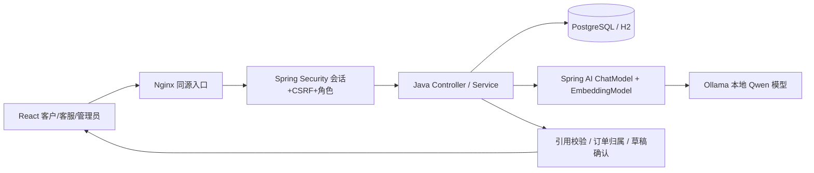
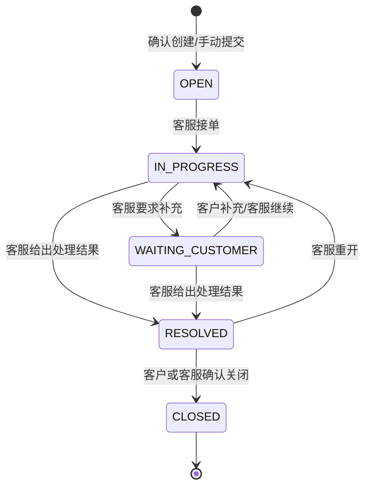

# 架构与关键实现

Java 业务层采用显式 JDBC 与参数化 SQL，重要写操作使用 Spring 事务。数据库结构由 `backend/src/main/resources/db/migration/V1__initial.sql` 维护。服务默认单实例，内存会话及模型并发限流没有分布式共享；扩展副本前需迁移会话、分布式任务锁与限流。

## 表与关系

| 表 | 职责 |
|---|---|
| app_users | 用户、BCrypt 密码、CUSTOMER/AGENT/ADMIN 角色 |
| products / shop_orders | 商品与固定模拟订单；金额使用整数分 |
| tickets / ticket_events | 工单主记录、版本、处理人、回复与状态历史 |
| knowledge_documents / knowledge_chunks | 文档状态、商品范围、片段、嵌入向量和模型名 |
| chat_threads / chat_messages | 会话归属、消息、引用和业务结果快照 |
| chat_runs | 幂等键、请求原文、运行状态、模式、耗时、结果 |
| proposals | 待确认草稿、到期时间及最终工单关联 |
| audit_log | 操作者、行为、资源和业务摘要 |

引用快照随回答保存，即使后续停用文档，历史消息仍可解释当时的依据。新增知识创建新文档；当前版本不支持在线编辑原文，旧资料应停用后上传新版本。

## 工单状态

客服不能从待受理直接跳到已关闭；解决和要求补充必须填写说明。客户只能回复或关闭已解决工单。关闭后不允许再修改；需要继续帮助时创建新工单。

## 并发和失败处理

- 创建工单先锁定该客户的用户行，再检查 `owner + Idempotency-Key`，相同内容返回同一工单，不同内容返回 409。
- 更新工单锁定工单行并核对 `version`；两个客服同时提交时只接受一个版本，另一个得到 409，必须刷新后重试。
- 草稿确认按“用户 → 草稿”的顺序加锁，避免重复创建及锁顺序冲突。15 分钟过期后返回 410。
- 模型只有两个并发槽，每名用户同时一条咨询；模型调用超时为 90 秒，HTTP 读取超时 95 秒。超时/格式错误进入明确的降级模式，售后改为手动申请。
- 已完成咨询的相同幂等键直接回放结果；失败或中断且结果未知时要求先查看会话记录，不自动重复写入。
- SSE 超时为 145 秒，包含阶段消息及最终结果。业务结果在入库后返回；网络断开时可在历史记录查看。

## 边界

模型输出不能直接当作 SQL 或执行指令。订单查询再次以登录客户过滤，来源 ID 只能取本次候选集合，未知引用全部拒绝。AI 不调用真实退款接口。当前没有用户自助注册和密码重置；正式接入应提供账户管理或企业身份系统，并按实际业务调整权限、售后审核和留存周期。
