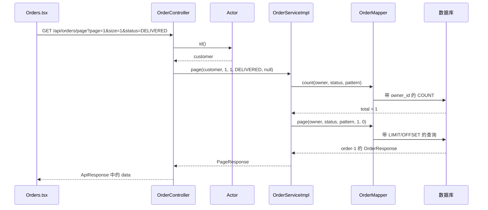

# 第一课：一条订单请求是怎么执行的

先打开 `backend/desk-domain/src/main/java/cn/liuyang/desk/service/OrderService.java`，再打开 `backend/desk-app/src/main/java/cn/liuyang/desk/service/impl/OrderServiceImpl.java`。接口写“能做什么”；实现写“怎么做”。原来单文件的业务代码现在在 Impl 中。

## 一、不要把文件从上到下当作执行顺序

`package` 指定类所属的包，`import` 让代码能使用其他类型，它们不是运行时的一条条业务命令。类里的字段和方法声明也不会在收到请求时全部依次执行。

启动时：`DeskApplication.main` 启动 Spring → 扫描根包及子包 → MyBatis 创建 OrderMapper 代理 → Spring 调用 OrderServiceImpl 构造器 → 把实现注入 OrderController。多个 Maven JAR 不妨碍同一根包下的组件扫描。

请求时：浏览器发 HTTP → Security 校验会话 → Controller 取参数和当前用户 → 调用某一个 Service 方法 → Mapper 查数据库 → 返回 DTO → 包装响应 → 序列化为 JSON → 前端取 data 并渲染。



## 二、逐句阅读类声明、字段和构造器

| 源码 | 作用、何时发生 |
|---|---|
| `@Service` | 将实现注册为 Spring 管理的对象；不用在控制器里自己 new |
| `implements OrderService` | 编译器检查这个类实现了接口承诺的方法 |
| `private final OrderMapper orders` | 保存数据库访问对象；private 限制访问，final 表示构造后不能改成另一个引用，并不代表对象内部绝对不可变 |
| `private static final Set<String> STATUSES` | 订单状态白名单；static 表示属于类，Set 用于判断是否包含某个状态 |
| `OrderServiceImpl(OrderMapper orders)` | 构造器，Spring 创建实例时传入 Mapper；方法参数 orders 和字段同名 |
| `this.orders = orders` | 左边是当前实例字段，右边是构造参数；把依赖保存起来，供以后请求使用 |

## 三、每个方法分别负责什么

| 方法 | 参数 | 返回 | 调用者 |
|---|---|---|---|
| list | owner：当前用户 ID | `List<OrderResponse>`，可能为空 | OrderController、AI 查询本人订单 |
| page | owner、page、size、status、query | `PageResponse<OrderResponse>` | 订单分页接口 |
| owned | owner、id（内部 ID 或订单号） | 一条订单；查不到抛 404 | 订单详情、创建工单、AI 订单工具 |
| eligible | order：已查到的订单；kind：申请种类 | void，满足规则正常结束，否则抛异常 | TicketServiceImpl 的 create/propose |

`list` 只有一条委托语句：`return orders.list(owner)`。调用 Mapper，等待结果，再把结果交回调用者。它不会接着执行 page 或 owned。

## 四、page 方法内部按什么顺序执行

1. `PageResponse.validate(page, size)`：页码至少 1，最多 1000000；每页 1～100。非法输入立刻抛异常，后面的 SQL 不执行。
2. `status = ... ? null : status`：将 null 或空白筛选条件统一成 null。三元表达式是一次条件选择。
3. 检查 `STATUSES.contains(status)`：非空但不在白名单，抛 400。
4. 检查 query 长度：超过 40，抛 400。先判断 null 再访问 length，防止空指针。
5. 算出 pattern：没关键词就是 null；有关键词则 trim，转义 `!`、`%`、`_`，两侧加 `%`。这是让输入中的通配符按普通字符查找；SQL 的参数绑定还负责防止输入被当作 SQL 指令。
6. `long total = orders.count(...)`：统计符合当前用户和筛选条件的总记录数。
7. `var rows = orders.page(...)`：获取这一页。var 是编译期推断类型，rows 的实际类型仍是 `List<OrderResponse>`，不是动态类型。
8. 偏移量 `(long)(page - 1) * size`：第一页从第 0 条开始；先转 long 避免使用 int 乘法。总页数由 PageResponse 计算。
9. `return PageResponse.of(...)`：构造不可变分页结果，方法结束。

`@Transactional(readOnly=true, isolation=REPEATABLE_READ)`：Spring 代理从外部调用该方法时创建读事务，尽量保证 count 和分页数据来自一致的事务视图。直接在 Mockito 单测中 new 出来的服务没有 Spring 事务代理；事务行为要用集成测试验证。

## 五、带入种子数据走一遍

以 customer 登录，在“我的订单”筛选已签收，每页 1 条。请求为 `/api/orders/page?page=1&size=1&status=DELIVERED`。

| 执行位置 | 变量此时的值 |
|---|---|
| Controller 中 | page=1，size=1，status="DELIVERED"，query=null |
| Actor.id() 返回 | owner="customer"；这个值来自登录会话，不来自浏览器传来的 owner 参数 |
| Service 参数检查后 | status 保持 DELIVERED，pattern=null |
| count 返回后 | total=1 |
| page 查询前 | limit=1，offset=0 |
| page 查询后 | rows 中有 order-1，订单号 ZS20261030001 |
| 返回前 | items=rows，total=1，page=1，size=1，pages=1 |

HTTP JSON 的形状是：

```json
{"code":0,"message":"成功","data":{"items":[{"id":"order-1","order_no":"ZS20261030001","status":"DELIVERED"}],"total":1,"page":1,"size":1,"pages":1}}
```

上面为了阅读省略了订单的其他字段。浏览器 api.ts 检查 code，返回 data；Orders.tsx 通过 setPage/setRows 等状态更新显示列表。

把用户换成 customer2 后，SQL 的 owner_id 也随之改变。访问 customer 的 order-1 时，owned 返回 404；查不到和不属于自己采用同样的对外结果，避免泄露订单存在性。

## 六、owned 和 eligible 的逐句逻辑

owned 首先执行 `orders.owned(owner,id)`。Mapper 的 WHERE 同时包含 owner_id 和 `(id=? OR order_no=?)`。若返回 null，`throw ApiException.missing()` 立即跳转到异常处理器；否则 `return order`。

eligible 的条件由 `&&` 连接：不是 QUESTION，且订单不是 DELIVERED，才抛 409。QUESTION 可以咨询未签收订单；REFUND/EXCHANGE/REPAIR 必须已签收。这只是接受售后申请，不代表已经退款。

对照：order-1 已签收，REFUND 通过资格检查；order-2 运输中，REFUND 被拒绝，但 QUESTION 可以；order-3 属于 customer2，customer 在调用 eligible 之前就会被 owned 拦住。

## 七、实际调试

在 OrderController.page、OrderServiceImpl.page 的 count 行、OrderMapper 对应 SQL 处各放断点。启动 DeskApplication（临时关闭 AI_ENABLED），登录后改变筛选。观察 owner、pattern、total、rows；先单步越过数据库代理，不必钻进所有框架源码。

纯单测入口：`OrderServiceTest.pageEscapesWildcardsAndKeepsOwnerScope`。执行：

```powershell
.\backend\mvnw.cmd -f backend/pom.xml -Punit "-Dtest=OrderServiceTest" test
```

练习：在纸上计算 page=3、size=10 的 offset，然后预测非法 page=0 时会不会访问 Mapper。用测试中的 verifyNoInteractions 检查你的预测。
