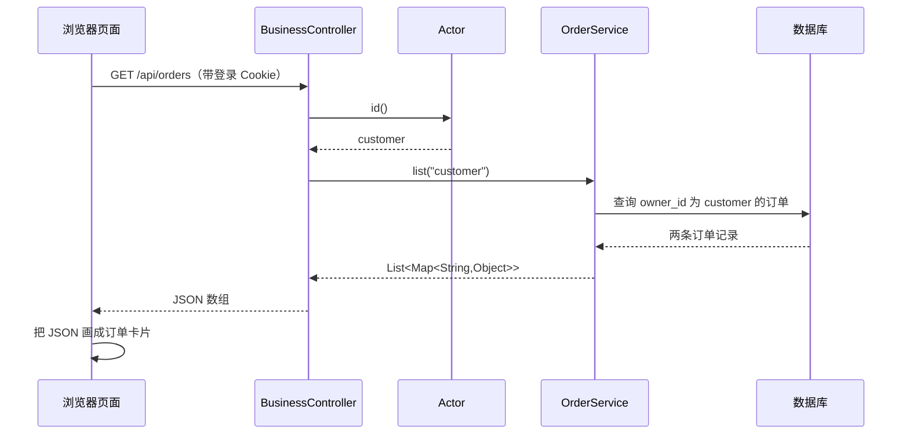

# 从 Java 基础读懂这个项目

适用情况：学过变量、条件判断、循环、方法和类，还没有系统学习 Spring Boot。目标是先看懂一次真实业务请求，再逐步理解工单和 AI。

**今天只做三件事：运行一个纯 Java 小例子；看懂一条订单查询；在网页中找到这条订单。** 不需要第一天理解整个项目，也不要从最长的 AI 类开始逐行背代码。

## 0 先知道你在看什么

这是两个程序加一个数据库：浏览器执行 React/TypeScript 页面；Java 后端接收请求、判断权限和处理业务；数据库保存用户、订单、工单。模型服务是后面才接入的另一个程序。



这里的“接口”首先指 HTTP 地址，例如 `/api/orders`，不是 Java 的 `interface` 关键字；它们是不同概念。

## 1 用熟悉的 Java 先演一遍

进入项目 `learning` 目录，运行：

```powershell
java OrderLesson.java
```

这是独立的教学文件，使用内存中的假订单，不启动 Spring，也不连接项目数据库。它只帮助理解“参数传进去 → 条件筛选 → 集合返回来”。实际输出保存在同目录 `expected-output.txt`。

如果 PowerShell 中中文显示乱码，可在该终端运行 `[Console]::OutputEncoding=[Text.UTF8Encoding]::new()`，再执行 `java '-Dstdout.encoding=UTF-8' OrderLesson.java`；这只调整当前终端输出编码，与订单查询逻辑无关。

先把 `currentUser` 从 `customer` 改为 `customer2`，预测结果再运行。再将查询订单号改成 `ZS20261030003`：如果仍以 customer 登录，为什么查不到？这就是“订单号正确”与“有权查看”之间的区别。

小例子里的 `Order` 是 Java `record`，可以先把它理解成存放订单号、所属用户、商品名称等数据的类。`new Order(...)` 创建一条订单；`List<Order>` 是多条订单的集合；`for` 依次查看每条；`equals` 比较字符串内容。不要用 `==` 判断用户名是否相同。

## 2 看最小的真实业务类

打开 `backend/src/main/java/cn/liuyang/desk/OrderService.java`。先只看 `list` 和 `owned`，暂时跳过 SQL 关联细节。

```java
public List<Map<String, Object>> list(String owner) {
    return s.db.queryForList(
        SELECT + "WHERE o.owner_id=? ORDER BY o.created_at DESC,o.id",
        owner
    );
}
```

源码可能排得比较紧凑，这里只是换行展开，执行含义相同。

| 代码 | 先这样理解 |
|---|---|
| public | 其他类可以调用此方法 |
| list | 方法名，表示查询订单列表 |
| String owner | 调用者传入的用户 ID |
| Map<String,Object> | 一条数据库记录：字段名对应字段值 |
| List<Map<String,Object>> | 多条记录组成的列表 |
| s | Store 类型对象，是构造器传进来的 |
| s.db | Store 里的 JdbcTemplate，帮忙执行 SQL |
| queryForList | 执行查询，并把每行转换成一个 Map |
| ? 和后面的 owner | 参数化 SQL 的占位符与参数 |
| return | 把查询结果交回调用这个方法的代码 |

例如一条 Map 可近似看成 `{id: "order-1", order_no: "ZS20261030001", owner_id: "customer", price_cents: 19900, status: "DELIVERED"}`。这是便于理解的表示，实际 Java Map 不是直接写这段 JSON 创建的。

执行到 `owner="customer"` 时，数据库只返回这个用户的订单。SQL 不是把前端传来的字符串直接拼进去；参数由数据库驱动绑定到 `?`，避免把用户名当作 SQL 代码执行。

`owned(owner,id)` 既检查所有者，也检查内部 ID 或订单号。它用的是 `s.one(...)`，找不到时抛出“未找到”异常。跟进 `Store.one`：查询列表 → 检查空列表 → 取第一条。此时只学这个方法，暂时跳过 hash、encode 和 audit。

## 3 找到是谁调用它

打开 `BusinessController.java`，定位：

```java
@GetMapping("/orders")
Object orders() {
    return orders.list(actor.id());
}
```

这个类上还有 `@RequestMapping("/api")`，两者合起来就是 `GET /api/orders`。浏览器访问这个地址后，Spring 找到对应方法并调用它；你不需要自己写一个 `while` 循环等请求。

**这一行的实际计算顺序：**

1. 先执行括号里的 `actor.id()`。
2. 它从已经通过认证的会话中取得当前用户，得到字符串 `customer`。
3. 再调用 `orders.list("customer")`。
4. `list` 查询数据库，返回两条记录。
5. Controller 返回这个 Java 集合。
6. Spring 的 JSON 转换组件把集合转换成 HTTP 响应体，浏览器拿到 JSON。

注意同名现象：`Object orders()` 的 `orders` 是方法名；`orders.list(...)` 的 `orders` 是类里的 `OrderService` 字段。不是“这个方法自己调用自己”。`Object` 是宽泛返回类型，实际返回的对象是列表；当前项目用它简化 Controller，学习时可关注真实对象的类型。

在 IDEA 中给 Controller 的返回行和 OrderService 的查询行打断点，Debug 启动开发后端，然后在开发前端点“我的订单”。观察 `actor.id()` 结果、`owner` 值和查询结果大小。运行 Docker 生产版时，这些本地源码断点不会自动拦住容器里的 JVM；初学调试用本地后端更直接。

## 4 再补三个 Spring 概念

打开 `DeskApplication.java` 找 `main`。`SpringApplication.run(...)` 启动应用并创建需要的组件。可以先理解成“启动 Web 服务器，并把相关类组织起来”，不用先读框架源码。

- `@RestController`：这个类有处理 HTTP 请求的方法，返回值通常交给 JSON 转换器。
- `@Service` / `@Component`：告诉 Spring 创建并管理这个类的对象。
- 构造器注入：`public OrderService(Store s){ this.s=s; }` 表示创建 OrderService 时需要一个 Store。Spring 找到已经管理的 Store，传给构造器。`this.s` 是成员变量，右边 `s` 是构造器参数。`final` 表示这个成员引用赋值后不再指向其他对象，不代表 Store 内部数据永远不能变。

`@GetMapping` 等注解像提供给框架看的标记；注解本身不是数据库查询，也不是线程。先记住它把“请求地址”和“Java 方法”关联起来。

## 5 理解“提交表单”与只读查询的不同

先在网页的“我的订单”点击“申请售后 / 咨询”，创建一张普通咨询工单。再读 `BusinessController.NewTicket` 和 `create`。

`@RequestBody` 把请求 JSON 转成 Java 对象；`@Valid` 触发参数校验；`@NotBlank` 要求非空白文本；`@Size(max=...)` 限制长度。`NewTicket` 是 record，`request.subject()` 取得标题；`trim()` 去掉首尾空白。

接着读 `TicketService.create`，按“检查类型 → 检查重复请求 → 查本人订单 → 写 tickets → 写事件 → 返回详情”的顺序。第一次只理解正常路径；第二次再看每一个 `throw`。`@Transactional` 把相关数据库写操作放在同一事务里，发生未处理异常时一起回滚，避免主工单写了但事件没写。

幂等键解决“同一请求点了两次是否创建两张”；`version` 解决“两个人同时修改是否覆盖对方结果”。不要把两个概念混成一个。

## 6 用测试理解规则

打开 `DeskIntegrationTest.java`，先读三个名字直观的测试：

1. `customerOnlySeesOwnOrders`：客户只能看到自己的两条订单。
2. `repeatedTicketCreationIsIdempotent`：同一请求重复提交返回同一个 ID。
3. `stateMachineRejectsSkippingIntake`：待受理不能直接跳到已关闭。

每个测试都按“准备数据 → 执行动作 → 断言结果”读。`assertEquals(expected, actual)` 表示期望值与实际值应相同；`assertThrows` 表示这个操作应该抛异常。测试不是业务代码的一部分，但能帮助你确认理解是否正确。

```powershell
.\backend\mvnw.cmd -f backend/pom.xml '-Dtest=DeskIntegrationTest#customerOnlySeesOwnOrders' test
```

这个测试使用隔离的内存数据库，并替换模型调用，不会查询真实客户数据。不要把测试里的 Mock 理解为系统正式运行也没有真实 AI。

## 7 业务看懂后再读 AI

顺序为 `ChatController.ask → ChatService.answer → KnowledgeService.search → AiGateway.plan → ChatService 的 switch`。

把模型先看成一个函数：输入“用户问题 + 候选资料”，输出 JSON。Java 校验 JSON，再选择“回答知识 / 查订单 / 准备工单草稿”。模型不是 Java 解释器，不会替代码自动获得权限。你需要先理解方法参数和返回值，再理解向量、余弦相似度及提示词。

建议用已有问题“阅读灯需要充电吗”跟踪变量 `question → sources → plan → result`；再换成申请退款，观察 `plan.intent` 如何让 switch 进入不同分支。生成 proposal 不等于 tickets 已新增；真正新增发生在客户确认后的 `TicketService.confirm`。

## 阅读节奏

| 次序 | 每次只回答一个问题 | 文件 |
|---|---|---|
| 第 1 次 | 输入用户 ID 后，怎样只得到自己的订单？ | OrderLesson、OrderService |
| 第 2 次 | 网页请求如何调用这个方法？ | BusinessController、Actor |
| 第 3 次 | 谁创建这些 Java 对象？ | DeskApplication、构造器 |
| 第 4 次 | 表单 JSON 怎样变成工单？ | NewTicket、TicketService.create |
| 第 5 次 | 客服怎样更新状态且避免冲突？ | TicketService.update、测试 |
| 第 6 次 | 未登录/另一个用户为什么被拒绝？ | AuthController、SecurityConfig |
| 第 7 次 | AI 如何参与，又由谁限制它？ | ChatService、AiGateway、KnowledgeService |
| 第 8 次 | 项目如何打包、启动、保存数据？ | pom.xml、application.yml、Compose |

不要求一天一个章节；能自己画出调用链、说出变量值、预测异常，再进入下一步。每次改一个很小的地方，在测试中验证；不要同时改页面、数据库、权限和提示词。简历可以描述项目实践，但面试前至少要亲自跑通并解释订单查询、草稿确认、幂等和状态机这四条主线。

## 本地调试的启动方式

在 IDEA 中以 Maven 项目打开 `backend/pom.xml`，选择 JDK 21，Debug 运行 DeskApplication.main；默认 http://127.0.0.1:19080，H2 数据位于运行目录的 `.runtime`。另开终端在项目根目录执行 `npm.cmd run dev --prefix frontend`，访问 http://127.0.0.1:19081；Vite 将 /api 请求代理到本地 Java。生产容器页面 19082 使用另外一个 Java 进程，数据也与 H2 分开。

如果只学习订单与工单，可在 IDEA 的环境变量中设 `AI_ENABLED=false`；这样无需等待模型。学习 AI 时再启用 Ollama。不要把学习中的 H2 数据库文件覆盖到 PostgreSQL 数据目录。
