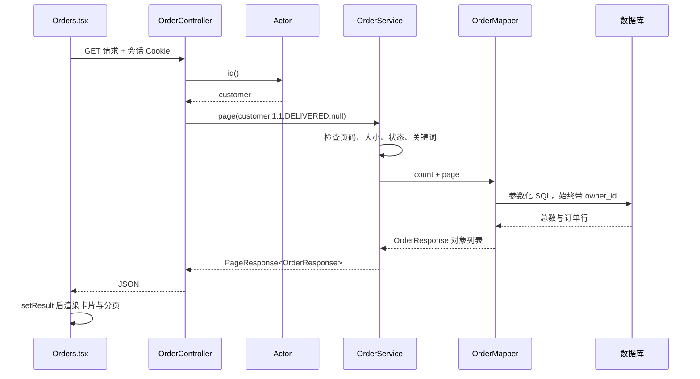

# Java 全栈学习路线：沿着这个项目逐步学

适合已经学过 Java 变量、方法和类，准备寻找实习或初级 Java 全栈岗位的读者。本文对应 2026-11-02 的扩展版，先看 [文件阅读顺序](文件阅读顺序.md)，再完成本页的练习。每个阶段都应自己修改、运行和解释一次；安装了某个依赖不等于掌握它。

## 1. 已经加入哪些内容

| 能力 | 本项目的实际实现 | 入口 |
|---|---|---|
| Java 对象与泛型 | OrderResponse/ProductResponse/IndexJob record、PageResponse<T>、CatalogCache 接口和两种实现 | 后端同名 Java 文件 |
| 分层与 MyBatis | OrderController → OrderService → OrderMapper；商品 Controller → Service → JDBC Repository | 订单与商品模块 |
| 数据库 | H2、PostgreSQL、MySQL；Flyway V1/V2；分页、联合索引、事务和外键测试 | resources/db、SQL 实验 |
| 前端工程化 | 独立页面、React Router、AuthContext、订单类型、表单校验、服务端分页、CSV 下载 | frontend/src |
| Redis | 可选商品目录缓存，数据库版本号控制失效，30 秒 TTL，异常回源，命中/错误计数 | RedisCatalogCache |
| RabbitMQ | 可选后台索引队列，任务落库、重复消费保护、租约、重试、恢复、死信队列 | IndexJob*、IndexQueueConfiguration |
| 自动验证 | 业务测试、真实中间件测试、请求/SSE 测试、桌面/手机尺寸 Chromium E2E、GitHub CI | backend/src/test、frontend/e2e |
| 运维 | Compose 组合部署、独立 MySQL 演示、内部指标端口、Prometheus 告警规则、HTTPS 示例、诊断脚本 | compose*.yaml、deploy、scripts |
| 语言与原理训练 | 可运行的 Java 基础、并发、SQL 索引实验；JVM/网络/操作系统/微服务学习题 | learning、本文及进阶指南 |

当前仍是单体业务系统。Redis 用于商品缓存，尚未接管登录会话或限流；RabbitMQ 在同一后端进程内消费。未声称实现 Spring Cloud/Nacos、分布式事务、集群高可用或真实退款。这些内容在 [进阶原理与运维](进阶原理与运维.md) 中给出后续练习，不需要同时引入所有框架。

## 2. 第一阶段：从纯 Java 到一个真实请求

在项目根目录运行：

```powershell
java learning/FullstackBasics.java
```

按文件里的 Order → OrderRepository → MemoryOrders → OrderService → main 顺序阅读：

1. Order record 的字段是什么类型，为什么金额保存为整数分？
2. OrderRepository 是接口；MemoryOrders 用 implements 提供实现。构造方法接收接口为什么能传入实现类？
3. private final 保存什么？为什么赋值语句要写 this.repository？
4. List<Order> 和 List<Map<String,Object>> 的区别是什么？字段拼错在什么时候能发现？
5. record 的 equals/hashCode 如何影响 Set 去重？不要把可变对象中参与 hashCode 的字段在入集合后修改。
6. stream 的 filter、sorted、skip、limit 分别在做什么？它们不会自动把内存处理变成数据库查询。
7. page=0 时异常在哪一层抛出，谁负责处理？

自己增加 CANCELLED 订单，并写一个方法只返回当前用户已签收的订单。能不看答案完成后，再进入 Spring 项目。

## 3. 第二阶段：理解订单分页的完整执行顺序

示例：客户登录后访问 `/api/orders/page?page=1&size=1&status=DELIVERED`。



这个种子示例会得到 total=1、pages=1，items 内含 ZS20261030001。尝试搜索另一位客户的 ZS20261030003，应得到空结果；前端隐藏按钮不能替代后端校验。

源码重点：

- OrderController：接收 HTTP 参数；用户身份来自 Actor，不能信任页面传来的 owner。
- OrderService：处理参数、转义 LIKE 通配符、定义一致性读事务、组织响应。
- OrderMapper：MyBatis 为接口生成实现；`#{owner}` 是绑定参数，不要改为拼接 `${owner}`。
- OrderResponse：一行查询结果的 Java 类型；@JsonProperty 保留原来的 JSON 字段名。
- PageResponse：通用分页结果。page 从 1 开始，offset=(page-1)*size。

动手任务：增加“按下单时间筛选”，先写越权、空结果和边界时间测试，再改 SQL 和页面。不能通过删除 owner 条件让测试通过。

## 4. 第三阶段：SQL、事务和两种数据访问方式

对比 OrderMapper 的 MyBatis 和 ProductRepository 的 JdbcTemplate/RowMapper。两种方式都需要懂 SQL；MyBatis-Plus 可以作为后续同模块替换练习，不必在同一个模块同时堆叠多个持久层框架。

运行 [SQL 索引实验](实验运行说明.md)，观察建索引前后的扫描方式、扫描行数、排序和耗时。实验使用临时表，不修改业务数据。不要用两条种子数据推断生产性能。

阅读 ProductService.save：保存商品、递增目录版本、写审计在同一个事务中提交。TicketService 演示工单状态机、行锁和版本冲突。思考：

- @Transactional 为什么需要通过 Spring 代理调用？同类方法直接调用会不会建立一个新的代理事务？
- 什么时候回滚？捕获异常后继续返回成功会带来什么问题？
- 行锁和 version 分别解决什么问题？只有查到版本号、没有原子更新或锁，够不够？
- MySQL 与 PostgreSQL 的排序规则、大小写比较、日期/布尔类型是否完全相同？

MySQL 迁移文件使用显式 FOREIGN KEY，因为不能把内联 REFERENCES 在不同数据库中的行为视为相同。新增迁移应分别维护并运行两种数据库测试，不修改已发布 V1 的校验和。

## 5. 第四阶段：自己完成前端业务页面

阅读 main.tsx → AuthContext.tsx → App.tsx → pages/Orders.tsx → api.ts。

- main.tsx 只负责挂载应用、路由和登录状态容器。
- AuthContext 保存登录状态；URL 页码/筛选放在 React Router 搜索参数中，刷新后仍能恢复。
- App 定义页面路由和角色可见范围；后端仍独立执行授权。
- Orders 的 useEffect 发请求，使用 AbortController 取消过时请求。
- TicketForm 先做表单提示，后端再次校验；订单归属和业务状态不能依赖前端。
- Tickets 从服务端分页筛选，不再只在已加载的前 200 条数据里搜索。
- CSV 导出限制 1000 条，服务端校验可见范围，并对电子表格公式前缀进行转义。

先学 HTML 表单、CSS Flex/Grid、JavaScript Promise/async/await、数组操作，再理解 React props/state/effect/context 和 TypeScript interface。目标岗位要求 Vue 时，再用 Vue 3 重做一个订单页对比组件和路由，不需要先重写整个项目。

## 6. 第五阶段：缓存与异步任务

Redis 阅读顺序：CatalogCache → NoCatalogCache → RedisCatalogCache → ProductService → ProductRepository。

缓存键形如 `desk:catalog:v12`。版本来自数据库，每次商品写入与版本递增共同提交；读缓存失败则读数据库。旧版本即使仍在 Redis 里，也不会被新版本查询使用。代价是每次仍有一次小型版本查询；不要声称消除了所有数据库访问。事务内读取不写共享缓存，避免把未提交数据缓存出去。旧键 30 秒过期，命名空间应随不同数据库隔离。

索引任务阅读顺序：IndexJobController → IndexJobService → IndexJobDispatcher → IndexQueueConfiguration → IndexJobProcessor → KnowledgeService。

1. 管理员提交任务，数据库记录 PENDING 后即可返回 202。
2. 默认后台调度器直接消费任务；启用 RabbitMQ 后先投递任务 ID。
3. 消费者用条件 UPDATE 抢占任务，重复消息不会重复完成同一个任务。
4. 每个片段处理前后续租；旧消费者失去 lease_token 后不能覆盖新消费者的任务状态。
5. 模型不可用会进入 RETRY，最多自动尝试 3 次，再变为 FAILED。
6. 数据库任务记录同时充当待投递记录；发送失败仍保留，后续调度会再次尝试。交付语义是至少一次，不能宣称消息绝不会重复或 exactly-once。
7. 进程中断时 RUNNING 任务在租约过期后恢复。模型端是否执行完毕不能仅凭本地超时判断，索引更新需要可重复执行。

动手任务：在独立测试环境暂停 RabbitMQ，提交任务后观察 PENDING，恢复后确认继续处理。再模拟模型不可用和重复消息。不要在真实业务库运行破坏性故障实验。

## 7. 第六阶段：测试、部署和面试表达

先运行本地测试，再运行真实中间件和浏览器测试，命令见 [实验运行说明](实验运行说明.md)。CI 的模型是 Mock；真实模型验收脚本另外运行，不能把数据库测试通过表述成 AI 准确率 100%。

能够独立完成“新增一个筛选条件 → 修改接口与 SQL → 页面联调 → 补测试 → 提交 Git → 查看 CI → 部署并排错”，就具备了可展示的端到端实践。简历只写自己能解释、复现和修改的部分；AI 辅助实现的内容也应说明自己的理解与验证工作。

继续学习 JVM、网络、操作系统、算法、微服务设计时使用 [进阶原理与运维](进阶原理与运维.md)。这些知识需要练习和测量，不靠增加 Maven 依赖就算完成。
