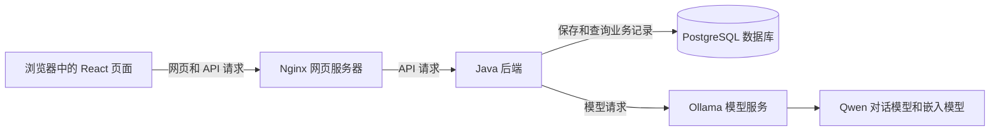

# 项目结构与文件职责

本文路径均相对于 `java-ai-service-desk` 项目根目录。本文依据当前源码整理，用于刚学完 Java 后查找功能和跟踪调用。

## 一 先分清程序 类 方法

backend 下多个 Java 文件共同组成一个后端程序。DeskApplication.main 是启动入口；其他类由 Spring 创建并在需要时调用，不需要逐个点击运行。一个类可以有多个方法，一个方法完成一项具体工作。

例如：TicketService 是处理工单的类；其中 create 创建工单，update 更新工单。文件名和类名一致，但一个类不一定是一个单独运行的程序。

前端 React 在浏览器执行，后端 Java 在服务器执行，生产数据库 PostgreSQL 和模型平台 Ollama 是另外的服务。Java 通过数据库连接访问 PostgreSQL，通过 HTTP 访问 Ollama。

开发时可由 Vite 提供网页、Java 使用内嵌 H2 数据库；容器部署时由 Nginx 提供已编译的网页、Java 连接 PostgreSQL。Vite 不负责执行 Java，也不参与生产环境的模型推理。

## 二 顶层目录

| 路径 | 内容 | 阅读建议 |
|---|---|---|
| backend/ | Java 源码、测试、后端配置 | 先读这里的业务源码 |
| frontend/ | React 页面、请求代码、样式、前端构建配置 | 理解后端后对照页面 |
| scripts/ | 构建、启动、验收、备份、打包脚本 | 学部署时再读 |
| learning/ | 独立的纯 Java 订单练习 | 可用来补集合与参数传递基础 |
| docs/ | 架构、接口、部署、测试、演示和学习说明 | 查阅材料 |
| dist/ | 项目交付 ZIP 及校验文件 | 构建产物，不是主要源码 |
| .runtime/ | 本机运行文件、备份、临时验收目录等 | 不是业务源码；不要随便清理数据 |
| .tools/ | 本任务下载的 Maven 等工具和过程文件 | 不需要逐个学习 |

backend/src/main/java 是正式 Java 源码；backend/src/test/java 是测试。main/java 中的 main 是目录约定，不表示该目录下每个文件都有 main 方法。

## 三 每个 Java 文件的职责

以下文件都在 backend/src/main/java/cn/liuyang/desk。cn/liuyang/desk 对应 package cn.liuyang.desk，是这些类所在的包。

### 入口与基础支持

| 文件 | 职责 | 主要入口/方法 |
|---|---|---|
| [DeskApplication.java](../../backend/src/main/java/cn/liuyang/desk/DeskApplication.java) | 启动 Spring Boot 应用及 Web 服务，组织配置和组件 | main |
| [Store.java](../../backend/src/main/java/cn/liuyang/desk/Store.java) | 提供数据库操作对象和共用工具；查一条记录、转 JSON、生成 ID/时间/哈希、写审计 | db、one、encode、decode、id、now、hash、audit |
| [SeedData.java](../../backend/src/main/java/cn/liuyang/desk/SeedData.java) | 启动时按配置初始化管理员与演示用户、商品、订单、知识和演示工单 | run；addUser/order/doc 是内部辅助方法 |
| [HttpClients.java](../../backend/src/main/java/cn/liuyang/desk/HttpClients.java) | 配置后端 RestClient 的连接和读取超时，避免外部调用无限等待 | timeouts |

Store 是操作数据库的辅助类，不是数据库本身。它的 db 字段是 Spring 提供的 JdbcTemplate 对象。真实数据保存在 PostgreSQL 或 H2 中；SeedData 是这些演示记录最初的来源。

### 登录和权限

| 文件 | 职责 | 主要入口/方法 |
|---|---|---|
| [AuthController.java](../../backend/src/main/java/cn/liuyang/desk/AuthController.java) | 接收登录请求，校验密码，创建认证会话，限制频繁失败登录；提供当前用户、CSRF token 和应用信息 | login、me、csrf、meta |
| [Actor.java](../../backend/src/main/java/cn/liuyang/desk/Actor.java) | 从认证上下文获取当前用户，再查询用户资料；向业务层提供用户 ID 和是否为客服/管理员 | current、id、staff |
| [SecurityConfig.java](../../backend/src/main/java/cn/liuyang/desk/SecurityConfig.java) | 配置密码编码、哪些接口允许谁访问、会话、CSRF、允许的网页来源和退出登录 | passwords、csrfRepository、security |

AuthController 负责“登录这件事怎么处理”；SecurityConfig 配置“请求进来是否允许继续”；Actor 帮业务代码取得“当前这个请求是谁发的”。退出登录由 SecurityConfig 配置的 Spring Security 处理器处理，不是在 AuthController 中另写一个 logout 方法。

### 订单 商品 工单

| 文件 | 职责 | 主要入口/方法 |
|---|---|---|
| [BusinessController.java](../../backend/src/main/java/cn/liuyang/desk/BusinessController.java) | 提供订单、工单、商品、概览、审计的 HTTP 入口；接收并校验请求，再调用业务类或执行简单查询 | orders、order、tickets、ticket、create、update、confirm、overview、audit、商品方法 |
| [OrderService.java](../../backend/src/main/java/cn/liuyang/desk/OrderService.java) | 查询本人订单，阻止跨用户查单，检查订单能否受理售后申请 | list、owned、eligible |
| [TicketService.java](../../backend/src/main/java/cn/liuyang/desk/TicketService.java) | 工单的业务规则：列表/详情、创建、重复提交识别、状态流转、版本冲突、回复事件、AI 草稿及确认 | list、get、create、update、propose、confirm、event |

Controller 可以理解为“接收网页请求的入口”，Service 可以理解为“处理业务规则的类”。本项目有意保持结构紧凑，BusinessController 中的商品、概览和审计包含直接数据库操作；不能把当前代码描述成所有查询都经过独立 Service/Repository。

TicketService.propose 只创建待确认草稿，confirm 才会创建或返回正式工单。处理工单不等于执行真实退款，本系统没有支付网关。

### 知识库与 AI 咨询

| 文件 | 职责 | 主要入口/方法 |
|---|---|---|
| [KnowledgeController.java](../../backend/src/main/java/cn/liuyang/desk/KnowledgeController.java) | 接收管理员的知识列表、文本提交、文件上传、启停和索引请求；检查文件类型/编码等 | list、create、upload、active、index、indexOne |
| [KnowledgeService.java](../../backend/src/main/java/cn/liuyang/desk/KnowledgeService.java) | 保存资料、拆分片段、生成并保存嵌入向量、过滤停用/其他商品资料、计算相关程度并检索 | add、setActive、split、index、search、grams、lexical、cosine |
| [ChatController.java](../../backend/src/main/java/cn/liuyang/desk/ChatController.java) | 接收新建会话、历史消息和提问请求；提供普通 JSON 与 SSE 响应入口 | threads、create、messages、ask、stream |
| [ChatService.java](../../backend/src/main/java/cn/liuyang/desk/ChatService.java) | 组织完整咨询流程：检查会话归属和重复请求、查资料、调用模型、按意图查单/准备草稿/回答知识、保存过程与结果 | newThread、ownThread、messages、answer、selectSources |
| [AiGateway.java](../../backend/src/main/java/cn/liuyang/desk/AiGateway.java) | 通过 Spring AI 调用 Ollama 的对话与嵌入模型；定义提示词，校验模型计划 JSON，限制并发和超时，处理降级 | SYSTEM、plan、embed、bounded、fallback |

向量可以先理解为“把一段文字变成一串数字，以便比较两段文字是否相关”。KnowledgeService 负责找资料；AiGateway 负责联系模型；ChatService 决定如何把资料、模型结果和业务操作组合起来。

模型返回的是受限计划，例如 intent=ORDER 或 KNOWLEDGE；Java 再检查权限和数据。当前知识回答由后端拼接验证过的资料原文，不是把模型自由生成的任何文本直接展示给客户。

### 异常处理

| 文件 | 职责 | 例子 |
|---|---|---|
| [ApiException.java](../../backend/src/main/java/cn/liuyang/desk/ApiException.java) | 表示一个业务错误，携带 HTTP 状态和说明 | 未找到订单 404、状态冲突 409 |
| [ApiAdvice.java](../../backend/src/main/java/cn/liuyang/desk/ApiAdvice.java) | 将 Controller 处理过程中抛出的异常统一转换为 HTTP 状态及 JSON 错误；也处理参数和上传错误 | {"error":"记录不存在或无权访问"} |

Spring Security 在进入 Controller 前拒绝的请求由它自己的处理器返回；不是所有错误都会先走 ApiAdvice。

## 四 Java 周围的配置和数据文件

| 文件 | 职责 |
|---|---|
| [pom.xml](../../backend/pom.xml) | Maven 的后端项目说明：Java 版本、所需库、编译/测试/打包插件 |
| [application.yml](../../backend/src/main/resources/application.yml) | 后端运行配置：端口、数据库、Cookie、上传大小、模型名、超时、演示开关 |
| [V1__initial.sql](../../backend/src/main/resources/db/migration/V1__initial.sql) | 创建业务表、索引和约束；启动时 Flyway 按迁移版本管理执行 |
| backend/mvnw.cmd | Windows Maven 启动包装脚本 |
| backend/mvnw | Linux/macOS Maven 启动包装脚本 |
| backend/.mvn/wrapper/maven-wrapper.properties | 指定包装脚本使用的 Maven 下载地址和版本 |
| backend/Dockerfile | 将已编译 JAR 与 Java 运行环境组装成容器镜像 |
| backend/.dockerignore | 限制发送给 Docker 构建的文件 |
| backend/target/ | Maven 生成的 class、JAR、测试报告等，不是手写源码 |

pom.xml 管理“编译需要什么”；application.yml 管理“运行使用什么配置”。不用修改 pom.xml 来设置数据库密码。

V1__initial.sql 包含 12 张业务表：

| 表 | 保存的数据 |
|---|---|
| app_users | 用户名、显示名、密码哈希、角色 |
| products | 商品名称、分类、价格、说明、上下架 |
| shop_orders | 订单号、所属用户、商品、金额、状态和时间 |
| tickets | 工单正文、状态、处理人、版本及幂等信息 |
| ticket_events | 每次回复、创建和状态变化 |
| knowledge_documents | 文档标题、适用商品、版本、是否有效 |
| knowledge_chunks | 文档片段正文、嵌入向量及模型名 |
| chat_threads | 一次会话及其所属用户 |
| chat_messages | 会话中每条用户消息和助手回复 |
| chat_runs | 每次咨询运行的请求、状态、模式、耗时与结果 |
| proposals | 尚未确认的工单草稿、过期时间、确认后的工单 ID |
| audit_log | 谁在什么时候进行了什么关键操作 |

数据库还会有 Flyway 自身的迁移历史表，那是框架记录，不是额外业务模块。

当前项目用 List<Map<String,Object>> 表示多行数据库记录，用 Map<String,Object> 表示一行。因此没有单独的 Order.java、User.java 实体类，也没有按表拆成一组 Repository 类。请求数据对象常以 record 写在 Controller 里面，例如 NewTicket、TicketUpdate 和 Question。

## 五 前端每个文件与页面的职责

| 文件 | 职责 |
|---|---|
| [frontend/index.html](../../frontend/index.html) | 浏览器最初读取的 HTML，提供 root 容器并载入前端入口 |
| [frontend/src/main.tsx](../../frontend/src/main.tsx) | React 启动入口、应用导航和所有主要页面组件 |
| [frontend/src/api.ts](../../frontend/src/api.ts) | 向 Java 发送 HTTP 请求，携带会话与 CSRF，处理错误，解析 SSE |
| [frontend/src/style.css](../../frontend/src/style.css) | 页面颜色、间距、布局、按钮、弹窗和手机响应式样式 |
| frontend/public/favicon.svg | 浏览器标签页图标 |
| frontend/package.json | 前端依赖和 dev/build/test 命令 |
| frontend/package-lock.json | 锁定依赖实际安装版本 |
| frontend/tsconfig.json | TypeScript 类型检查配置 |
| frontend/tsconfig.tsbuildinfo | TypeScript 构建产生的缓存，通常不手动编辑 |
| frontend/vite.config.ts | Vite 配置；开发时将 /api 请求转发给本地 Java 后端 |
| frontend/nginx.conf | 生产环境提供静态页面、转发 /api、配置缓存与响应头 |
| frontend/Dockerfile | 将已构建网页和 Nginx 配置装进容器镜像 |
| frontend/.dockerignore | 限制网页镜像构建时发送的文件 |
| frontend/node_modules/ | npm 下载的外部库 |
| frontend/dist/ | Vite 编译后的网页文件；与根目录 dist/ 交付压缩包用途不同 |

main.tsx 中页面目前集中在一个文件，查某页时搜索对应的 function 名字：

| 组件或函数 | 页面/职责 |
|---|---|
| App | 保存当前登录用户、当前页面、导航菜单、提示消息，选择展示哪个页面 |
| Login | 登录表单、演示角色选择、提交登录 |
| Chat | 咨询输入、发送问题、接收阶段和回答、历史会话、引用、订单卡片 |
| Proposal | 在聊天中展示 AI 工单草稿，点击确认后调用后端创建工单 |
| Orders | 我的订单卡片、打开关联订单的售后表单 |
| TicketForm | 手动创建工单的表单，收集订单、类型、标题、描述 |
| Tickets | 工单列表、筛选、详情、时间线、客服修改状态、客户补充和关闭 |
| Overview | 客服/管理员概览：工单数量、近期需求、AI 运行记录 |
| Knowledge | 管理员知识上传、发布/停用、向量索引及状态展示 |
| Products | 管理员新增、编辑、上架/下架商品 |
| Audit | 管理员查看关键操作记录 |
| PageTitle | 各页共用的标题、说明和操作区 |
| Badge | 把状态值显示成有颜色的状态标签 |
| Loading | 正在加载提示 |
| Empty | 无数据提示 |
| Modal | 弹窗外壳和关闭操作 |
| money、date | 金额与日期显示格式转换 |
| statusName、kindName | 将状态/类型英文值映射成中文名称的常量 |
| createRoot(...).render(<App/>) | 将整个 React 应用挂到 HTML 的 root 容器 |

api.ts 中 refreshCsrf 获取 token，api 是通用请求函数，post 简化 POST 请求，askStream 读取 phase/result/error 等 SSE 事件。SSE 可以先理解成“服务器保持连接，在处理过程中陆续发送消息”，这里用于处理阶段和最终结果，不代表原样输出所有模型 token。

## 六 测试与脚本

| 文件 | 职责 |
|---|---|
| [DeskIntegrationTest.java](../../backend/src/test/java/cn/liuyang/desk/DeskIntegrationTest.java) | 检查 HTTP 权限、订单隔离、工单状态/幂等/版本、草稿确认等业务行为；测试中替换真实模型 |
| [GroundingTest.java](../../backend/src/test/java/cn/liuyang/desk/GroundingTest.java) | 检查文本分段、余弦计算、降级不写业务、引用不能伪造、原文保持 |
| [AiGatewayTest.java](../../backend/src/test/java/cn/liuyang/desk/AiGatewayTest.java) | 检查模型只接收本次请求的短引用编号、后端正确映射真实 ID、无效/跨请求编号与原始 UUID 无法绕过校验、非法 JSON 只读降级 |
| [frontend/tests/api.test.mjs](../../frontend/tests/api.test.mjs) | 检查请求封装、CSRF、错误提示、SSE 字节分片和断线处理 |
| scripts/build.ps1 | Windows 构建入口：后端测试打包、安装前端依赖、前端测试和编译 |
| scripts/build.sh | Linux/macOS 对应的构建入口 |
| scripts/init-env.ps1 | 首次生成本机 .env 与随机数据库密码，保留已有配置 |
| scripts/start.ps1 | 检查编译产物、准备配置、按选项准备模型、启动 Compose 服务 |
| scripts/http-acceptance.mjs | 对运行中的真实 HTTP 服务检查登录、权限、并发幂等、版本冲突、SSE 等 |
| scripts/live-acceptance.mjs | 真实模型场景验收，保存响应和耗时，并执行草稿确认到工单关闭流程 |
| scripts/backup.ps1 | 从 PostgreSQL 导出备份并保存 SHA256 |
| scripts/verify-restore.ps1 | 在独立临时数据库容器中恢复备份、查询结果并清理该临时容器 |
| scripts/sanitize-evidence.py | 去掉 JUnit 报告中的环境属性和控制台输出，保留测试结果 |
| scripts/package.py | 当前交付包打包脚本：源码、编译产物、文档、学习材料及逐文件校验清单 |
| scripts/package-release.py | 较早的打包脚本，输出英文名称 ZIP；有重复功能，当前使用 package.py |

这些脚本不是 Java 业务服务。测试脚本只在验收时执行；不要把会创建测试记录的脚本当成普通查询脚本在正式数据库上运行。

## 七 根目录配置 文档 教学材料

| 文件/目录 | 职责 |
|---|---|
| compose.yaml | 组合 db、api、web 三个容器，定义连接、数据卷、端口与健康检查 |
| compose.models.yaml | 可选增加独立 Ollama 模型容器与模型数据卷 |
| compose.gpu.yaml | 可选让 Ollama 使用 GPU |
| .env.example | 本地环境配置模板 |
| .env | 当前电脑的实际配置，含数据库凭据；不放入公开交付包 |
| .gitignore | 告诉 Git 哪些生成物、本机配置和依赖目录不应跟踪 |
| README.md | 项目入口、运行方式和文档导航 |
| THIRD_PARTY.md | 第三方依赖、素材和许可证说明 |
| docs/requirements.md | 截图要求与本项目实现范围的对应 |
| docs/architecture.md | 模块关系、数据关系、工单状态机和边界 |
| docs/api.md | HTTP 地址、请求字段、响应和错误 |
| docs/deployment.md | 构建、部署、配置、迁移、备份和故障排查 |
| docs/ai-integration.md | 模型调用、检索、提示词、降级及复现 |
| docs/ai-development-log.md | AI 辅助开发过程和实际问题记录 |
| docs/demo.md | 按业务流程演示系统的步骤 |
| docs/testing.md | 测试范围、结果和局限 |
| docs/verification/ | 测试 JSON/XML、截图等证据，不是应用逻辑 |
| docs/learning/从Java基础读懂项目.md | 阅读顺序、Java 语法和具体调用讲解 |
| learning/OrderLesson.java | 可单独运行的纯 Java 内存订单练习，不连接正式应用 |
| learning/expected-output.txt | 该练习的一次实际输出 |

## 八 跟着一个具体请求串起来

假设 customer 已登录，点击网页“我的订单”：

1. main.tsx 的 Orders 组件调用 api('/orders')。
2. api.ts 发出 GET /api/orders，并带上浏览器保存的会话 Cookie。
3. Nginx（开发时是 Vite）将请求转发给 Java。
4. SecurityConfig 配置的安全过滤器检查登录等条件。进入 Controller 后，orders() 执行 orders.list(actor.id())。
5. Actor.id() 得到 customer，作为参数传给 OrderService.list("customer")。
6. OrderService 用 Store.db 执行带 owner_id 条件的 SQL，数据库返回该客户的记录。
7. Spring 将 Java 集合转换为 JSON，前端把 JSON 交给 setOrders。
8. React 根据新数据重新绘制订单卡片。

需要分清两种调用：Orders 到 Java 是跨程序的 HTTP 请求；BusinessController 到 OrderService 是 Java 程序内部的方法调用。

AI 问答则是：Chat 页面 → api.ts.askStream → ChatController.stream → ChatService.answer → KnowledgeService.search 找资料 → AiGateway.plan 取得计划 → ChatService 校验并处理 → 保存消息/运行记录 → SSE 返回页面。返回的计划若要求查单或生成售后草稿，仍交给 OrderService/TicketService 检查业务条件。

## 九 第一遍怎样使用这份地图

先打开 OrderService.list；遇到 s.db 就到 Store 看字段与构造器；再回 BusinessController.orders 找调用者；遇到 actor.id 再读 Actor。每读一个方法，记录四点：谁调用它、参数是什么、内部做什么、返回什么。第一条订单查询跑通后再学习创建工单，最后学习 AI 与部署。
